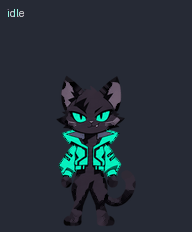
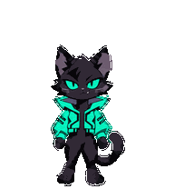
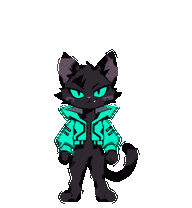
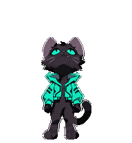

# Неон 🐈‍⬛

Чёрный киберкот с яркими глазами и бирюзовой технологичной курткой. Пользовательский персонаж, созданный с помощью генерации изображений: чистые контуры, cel shading, угловатый воротник, хвост и дерзкое выражение морды.



## Состав

| Папка | Содержимое |
|---|---|
| `references/canonical-base.png` | Исходный образ персонажа |
| `frames/` | Отдельные прозрачные PNG-кадры девяти анимаций |
| `final/spritesheet-standard.png` | Атлас стандартных анимаций |
| `final/spritesheet-extended.png` | Расширенный атлас, включая 16 направлений взгляда |
| `previews/final/` | GIF, MP4 и контактные листы готовых анимаций |
| `previews/standard/` | Ранние стандартные GIF-превью |
| `cli/neon/` | Атлас и манифест локальной CLI-версии |
| `brief.md` | Описание образа и исходный промпт |
| `prepare_cli_pet.py` | Упаковка первых девяти строк расширенного атласа |

Состояния: idle, running-right, running-left, running, waiting, review, jumping, waving, failed. Размер ячейки атласа — 192×208 пикселей, восемь колонок. Строки не обязательно используют все восемь кадров: для просмотра анимаций используй готовые GIF.

## Посмотреть





Для повторной упаковки CLI-атласа нужен Python и Pillow:

```powershell
python -m pip install Pillow
python prepare_cli_pet.py
```

Публикация этих файлов не устанавливает питомца автоматически в какое-либо приложение. Манифест `cli/neon/pet.json` сохранён в формате, использовавшемся в локальном проекте.

## Версия для ESP32

Монохромный анимированный Неон на OLED 128×64 находится в отдельном [проекте ESP32](https://github.com/k0zt3r/esp32/tree/main/ThermoDashboard/assets/neon). Кот отображается рядом с настоящей температурой DS18B20. Цветные исходники здесь не изменены.

Служебные идентификаторы питомца, локальные пути, зависимости генератора, промежуточные атласы и дампы инструментов не включены в публикацию. Лицензия пока не выбрана.
